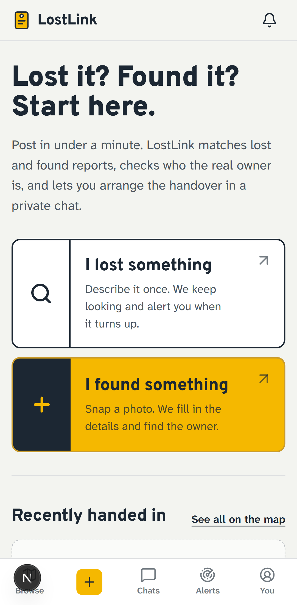
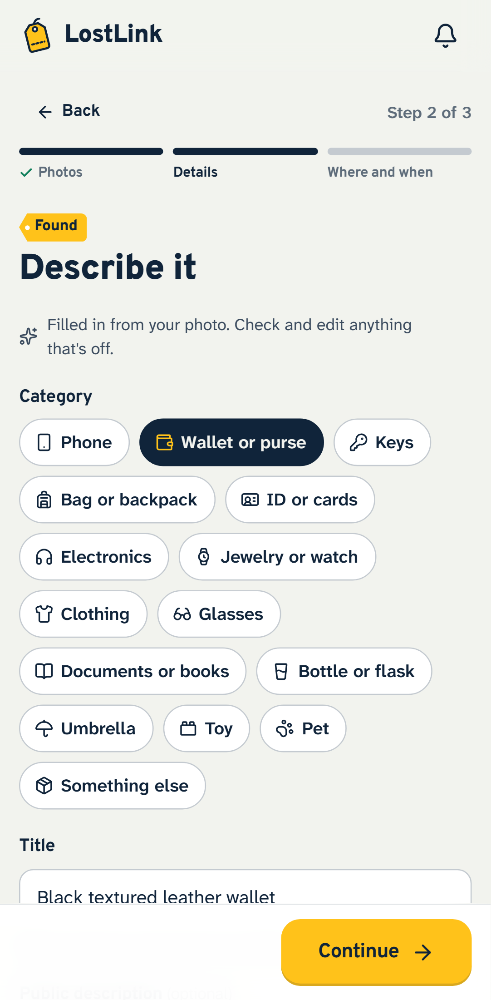
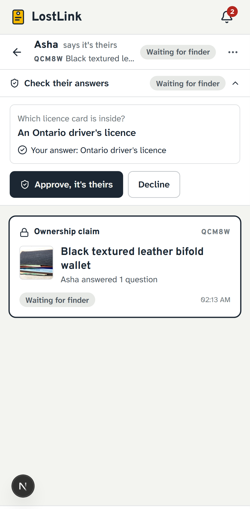
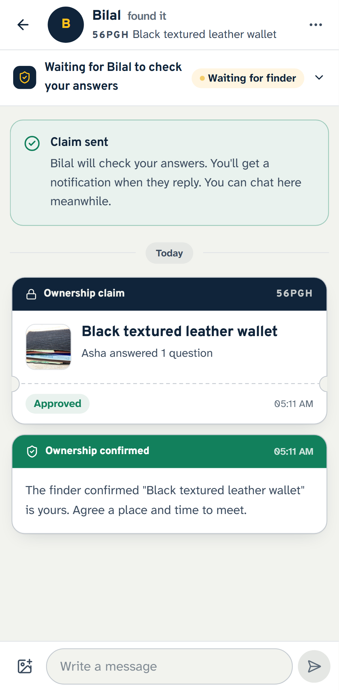
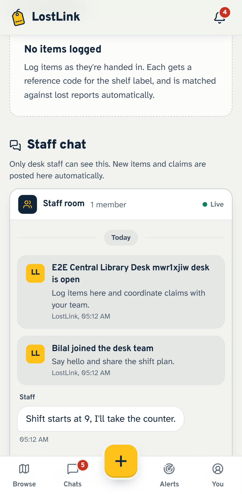
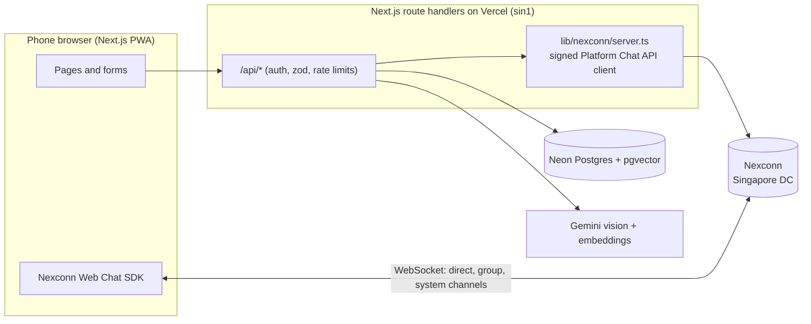
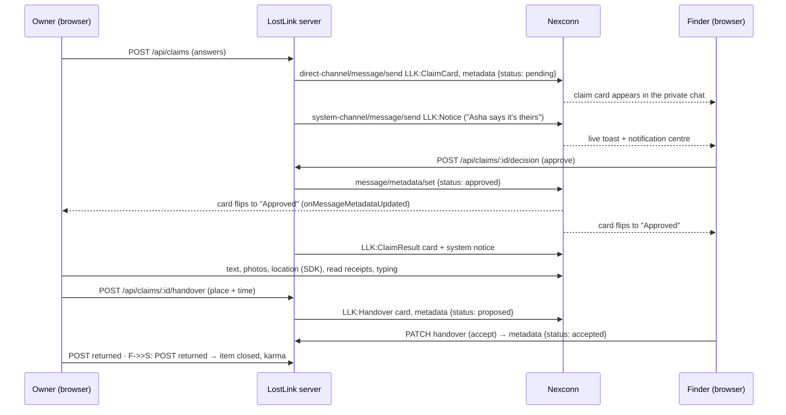

<p align="center">
  
</p>

<h1 align="center">LostLink</h1>

<p align="center"><strong>Lost it? Found it? Start here.</strong><br/>
The lost-property office in your pocket: post it, match it, prove it, and hand it back in a private chat, without swapping phone numbers.</p>

<p align="center">
  <a href="https://lostlink-bay.vercel.app"><strong>Live app → lostlink-bay.vercel.app</strong></a><br/>
  Mobile-first, installable as an app (PWA). Built on Nexconn real-time chat.<br/>
  <a href="docs/LostLink-demo.mp4">Demo video (3 min)</a> · <a href="docs/LostLink-Nexconn-Integration.pdf">Nexconn integration guide (PDF)</a>
</p>

---

## What LostLink is

When you lose a wallet, keys or a phone, someone has often already found it. The hard part is
finding each other, and proving it's really yours without handing your number to a stranger.

LostLink fixes that in four steps:

1. **Post** – snap a photo and drop a pin. AI reads the photo and fills in the category, colour,
   brand and marks for you. Takes under a minute.
2. **Match** – every new post is compared with what's been lost or found nearby, by description,
   place and time. Both people get a live alert.
3. **Prove it** – the finder keeps identifying details (what's inside, an engraving) private and
   turns them into questions. The owner answers; the finder sees the answers next to their own and
   approves.
4. **Meet** – a private chat opens. They agree a busy public spot and a time on a map, meet, and
   both tap **Returned**. The owner can say thanks; the finder earns karma.

Venues (campuses, malls, stations, events) can run a **lost & found desk**: a public page, a
printable QR poster, a shared inventory that matches itself, and a private staff chat.

<p>
  
  
  
  
</p>
<p>
  
  
  
  
</p>

## Features

| | |
| --- | --- |
| **Report in under a minute** | Photos are resized on the phone and stored in Vercel Blob. Gemini vision pre-fills category, title, colour, brand, material and marks; if the AI is busy the form simply stays manual. Pin or "use my location"; exact time or a range. |
| **Private verification** | Found items hide brand, material and marks publicly, and the pin is blurred to about 300 m. Finders set questions only the owner can answer. Repeated wrong claims are refused. |
| **AI matching with reasons** | `gemini-embedding-2` vectors (768 d) in pgvector, filtered by category, distance and time, ranked with readable reasons such as "Same brand: Apple, 400 m away, found 2 h after you lost it". |
| **Live notifications** | Matches, alert hits, claims, decisions and handover updates arrive instantly as Nexconn system messages and wait in the in-app notification centre. |
| **Claim → chat → handover** | A claim card lands in a private chat; its state (waiting → approved → returned) updates live on both phones. Text, photos, read receipts, typing, meeting point on a map, handover card, "Returned" on both sides, thank-you note, karma. |
| **Alerts** | "Tell me if a black wallet is found within 3 km of here", checked on every new found post. |
| **Desks** | Public desk page, QR poster (PNG and print-ready A4 PDF), staff invite link, staff group chat with bot notices, self-matching inventory. |
| **Browse** | Map or list, search, category chips, lost/found, date and distance filters. Shareable item pages with Open Graph cards. Posts expire after 60 days with a renew prompt. |
| **Safety** | Block or report from any chat, claim or post. Blocked people can't message you or claim your items; posts reported by three people are hidden automatically. |
| **Production basics** | PWA with offline page, favicon set and maskable icons, `robots.txt`, `sitemap.xml`, error and loading boundaries, rate limits on every write, zod validation on every input. |

## How Nexconn is integrated

LostLink uses Nexconn for **everything that has to be real-time and private**: claim chats,
live cards, notifications and staff rooms. The server talks to the **Platform Chat API** (signed,
the App Secret never leaves the server); the browser uses the **Web Chat SDK** over WebSocket.
Data centre: Singapore (`https://api.sg-light-api.com`).



### The claim flow, end to end

The server is the source of truth (Postgres). After every decision it sends or updates a Nexconn
message, so both phones change at the same moment.



### Every Nexconn feature we use

| Nexconn capability | How LostLink uses it | Code |
| --- | --- | --- |
| Access token issue (registers the user) | Every account is registered at sign-up. Tokens remember the App Key that issued them and are re-issued automatically if the key changes or after error 31004 | `src/lib/nexconn/users.ts`, `src/app/api/nexconn/token/route.ts` |
| Web SDK init and connection | One engine per tab, Singapore area, custom messages and handlers registered before connect, retry with backoff, "reconnecting" pill, multi-device kick (31010) | `src/components/chat/chat-provider.tsx` |
| Direct channels | The private claim chat between owner and finder | `src/components/chat/use-conversation.ts`, `chat-room.tsx` |
| Group channels | Desk staff room, created, joined and left through the server API; recreated with its members if missing under the current App Key | `src/lib/desks.ts`, `src/components/chat/group-chat.tsx` |
| System channel (server-sent) | Match, alert, claim, decision, handover and expiry notices from the `llklostlinkbot` sender | `src/lib/notify.ts` |
| Custom message types | `LLK:ClaimCard`, `LLK:ClaimResult`, `LLK:Handover`, `LLK:Notice`, `LLK:DeskNotice`, rendered as ticket-style cards | `src/lib/nexconn/messages.ts`, `src/components/chat/message-view.tsx` |
| Message metadata | Card state (claim and handover) updated by the server and pushed live to both sides | `src/lib/claims.ts`, `server.ts setDirectMessageMetadata` |
| Server-side direct messages | Authoritative cards sent with `isEchoToSender`, `verifyBlocklist`, `hasMetadata` | `src/lib/nexconn/server.ts` |
| Text, image and location messages | Chat text, photos with upload progress, meeting point with an OpenStreetMap thumbnail | `use-conversation.ts`, `src/lib/map-thumb.ts` |
| Read receipts | "Read" ticks on direct messages | `use-conversation.ts` |
| Typing indicators | "typing…" in the chat header | `use-conversation.ts`, `chat-room.tsx` |
| Unread counts and channel list | Badge on Chats, per-conversation unread and previews | `chat-provider.tsx`, `chat-list.tsx` |
| History pagination and offline sync | "Load earlier messages", refetch after `onOfflineMessageSyncCompleted` | `use-conversation.ts` |
| User blocklist | Block and unblock from the safety menu; re-synced from Postgres when a user is registered under a new App Key | `src/app/api/blocks/route.ts`, `users.ts` |

**Swapping the App Key is an env change only.** Users are re-registered lazily the next time
they connect or are messaged, their blocklists are copied back, and desk staff groups are recreated
with their members. All Nexconn ids are prefixed `llk` so the app can share a key with other apps.

## Design

The look comes from station wayfinding and lost-property claim tickets: transit navy `#10243A`,
wayfinding yellow `#FFC21A` for Found and primary actions, exit-sign green `#12805C` for returned
and approved, alert red `#C8321E`, on a cool paper `#F2F3EE`. Type is Overpass (descended from US
highway signage) for headings and Atkinson Hyperlegible for reading. Items are cut like claim
tickets with a perforated stub and reference code; the home page opens with a split-flap "lost
property board" of real posts, and "how it works" is a metro line that fills as you scroll.

## Tech stack

Next.js 16 (App Router, TypeScript strict) · Tailwind CSS 4 · Drizzle ORM on Neon Postgres with
pgvector · Vercel Blob · Gemini (`@google/genai`: vision pre-fill and `gemini-embedding-2`) ·
Nexconn Web Chat SDK + Platform Chat API · Leaflet + OpenStreetMap · `next/og` and `pdf-lib` for
posters and link previews · bcrypt + JWT cookie auth · zod · Playwright + Vitest · Vercel.

## Run it locally

```bash
npm install
vercel env pull .env.local --yes   # or create .env.local with the variables below
npm run db:migrate                 # applies drizzle/ migrations
npm run dev                        # http://localhost:3104
```

Environment variables (names only): `DATABASE_URL`, `DATABASE_URL_UNPOOLED`,
`BLOB_READ_WRITE_TOKEN`, `NEXCONN_APP_KEY`, `NEXCONN_APP_SECRET`, `NEXCONN_API_BASE`,
`NEXCONN_ID_PREFIX`, `SESSION_SECRET`, `CRON_SECRET`, `GEMINI_API_KEY`, `GEMINI_MODEL`,
`GEMINI_FALLBACK_MODEL`, `GEMINI_EMBED_MODEL`, optional `NEXT_PUBLIC_APP_URL`. Only the App Key
ever reaches the browser.

```bash
npm run typecheck && npm run lint
npm test                                                     # unit tests (Vitest)
npm run test:e2e                                             # two-user e2e against localhost:3104
E2E_BASE_URL=https://lostlink-bay.vercel.app npm run test:e2e   # against production
SCREENSHOTS=1 npm run test:e2e                               # also refresh docs/screenshots
node scripts/generate-icons.mjs                              # rebuild favicon and app icons
vercel deploy --prod                                         # build and deploy
```

The e2e suite drives the real stack (Nexconn, Gemini, Neon, Blob) with two phones: a lost post, a
found post with AI pre-fill, a live match notice, a claim, approval, chat with receipts and typing,
a meeting point, both sides confirming the return, a thank-you and karma; then a desk with its QR
poster, staff invite and staff chat. Test accounts delete themselves.

## Project map

```
src/app/            pages (App Router), API route handlers, icons, robots, sitemap, OG images
src/components/     app shell, chat (provider, room, cards, composer), landing, maps, forms, UI kit
src/lib/            db schema, Nexconn server client and user registration, claims state machine,
                    matching and scoring, Gemini, search, desks, notifications, posters
drizzle/            SQL migrations          e2e/   Playwright two-user tests
tests/              Vitest unit tests       docs/  screenshots, demo video, Nexconn integration PDF
```

See [AGENTS.md](AGENTS.md) for the architecture, data model, conventions and known limitations.

Test photo: "Leather bi-fold wallet by Eugene Pik (2021)", Wikimedia Commons, CC BY-SA 4.0.
