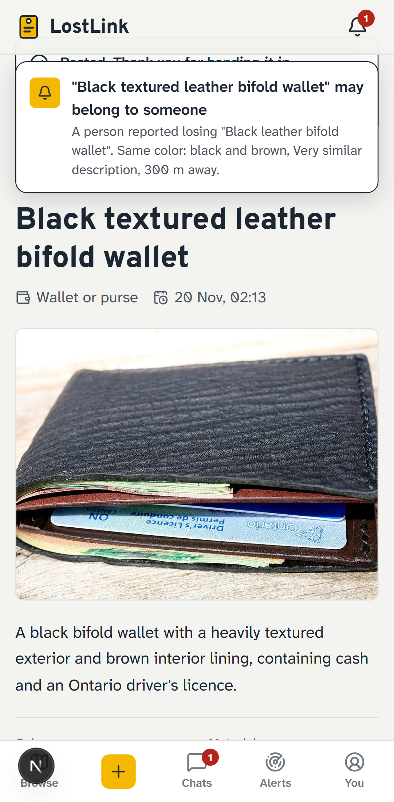
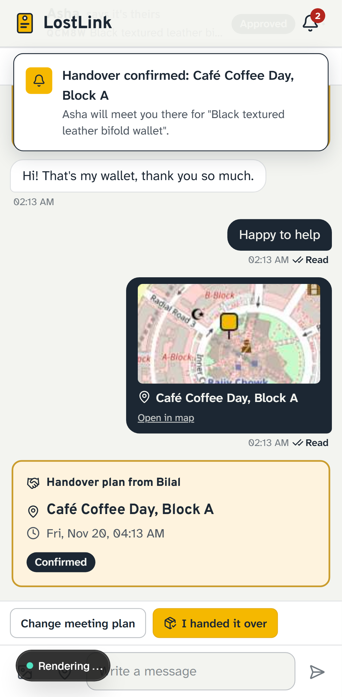
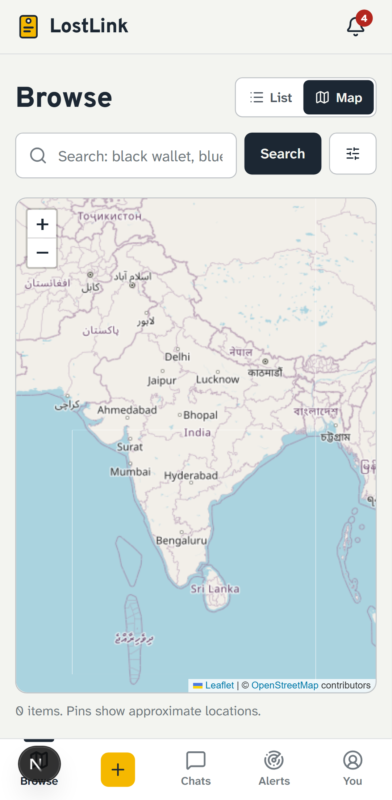
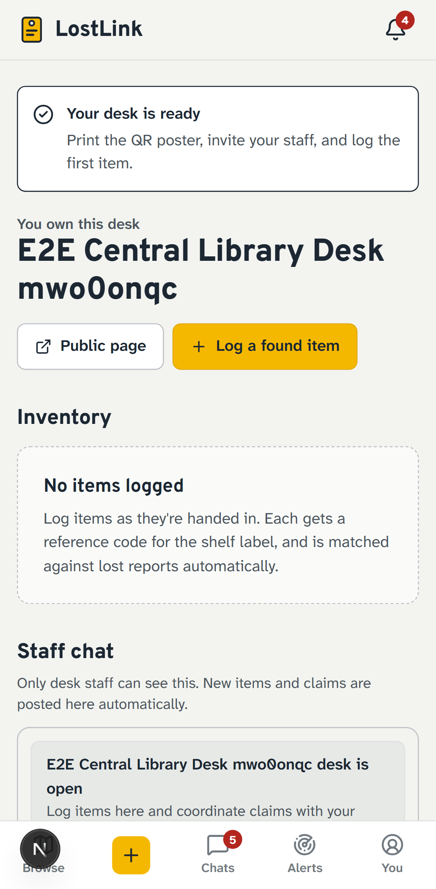
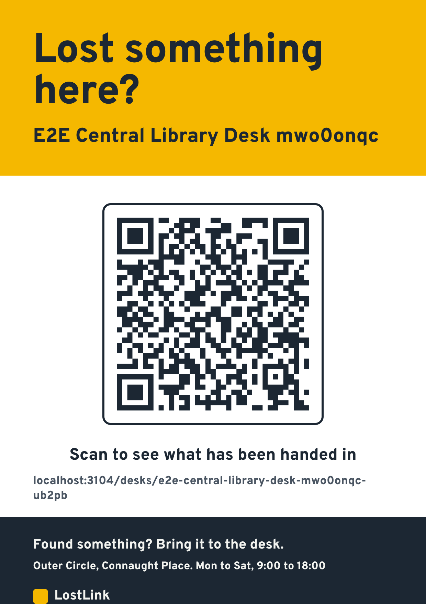

# LostLink

**Lost & found that actually reunites people with their things.**

Post what you lost or found in under a minute. LostLink reads your photo with AI, matches lost and
found posts by description, place and time, makes the claimant prove ownership with the finder's
private questions, and opens a private chat to agree a meeting point. Nobody shares a phone number.

**Live:** https://lostlink-bay.vercel.app (mobile-first, installable as a PWA)

<p>
  
  
  
  
</p>
<p>
  
  
  
  
</p>

## Features

- **Report in under a minute.** Photos are resized on the phone and uploaded to Vercel Blob.
  Gemini vision fills in category, title, colour, brand, material and distinguishing marks; you edit.
  Drop a pin or use your location; pick an exact time or a range.
- **Private verification.** Finders turn identifying details into questions only the owner can
  answer. The public page hides brand, material and marks and blurs the location to about 300 m.
- **AI matching.** `gemini-embedding-2` (768 d) vectors in pgvector, filtered by category,
  distance and time window, ranked with readable reasons: "Same brand: Apple, 400 m away, Found 2 h
  after you lost it". Recomputed whenever a post is created or renewed.
- **Live notifications.** Matches, alert hits, claims, decisions and handover updates arrive as
  Nexconn system-channel messages (a live notice in the app) and in the notification centre.
- **Claim → chat → handover.** "This is mine" sends a claim card into a private Nexconn direct
  channel. The finder sees answers next to the expected ones and approves or declines; the card
  updates live. They chat (text, photos, read receipts, typing), propose a meeting point (location
  message) and time (handover card), and both confirm "Returned". The owner can leave a thank-you
  note; the finder earns karma.
- **Alerts.** "Tell me if a black wallet is found within 3 km of here", checked on every new found post.
- **Lost & found desks** for campuses, malls, stations and events: public page, printable QR poster
  (PNG and A4 PDF generated by the app), staff invite link, a Nexconn staff group chat with bot
  notices, and an inventory that matches itself against lost reports.
- **Browse** on a map or as a list with search and filters; shareable item pages with Open Graph
  images; posts expire after 60 days with a renew prompt.
- **Safety.** Block or report from any item, claim or chat. Blocking uses the Nexconn blocklist;
  repeatedly reported posts are hidden automatically; repeated wrong claims are refused.

## How this uses Nexconn

| Nexconn capability | How LostLink uses it | Code |
| --- | --- | --- |
| Platform Chat API: access tokens | Every account is registered with Nexconn at sign-up; tokens refresh after error 31004 | `src/lib/nexconn/server.ts`, `src/app/api/nexconn/token` |
| Web Chat SDK connection | One engine per tab, Singapore data centre, handlers registered before connect, retry with backoff, reconnect banner, multi-device kick handling | `src/components/chat/chat-provider.tsx` |
| Direct channels | Private claim chat between owner and finder | `src/components/chat/use-conversation.ts`, `chat-room.tsx` |
| Group channels | Desk staff room: created, joined and dismissed through the server API; bot posts new items and claims | `src/lib/desks.ts`, `src/components/chat/group-chat.tsx` |
| System channel (server-sent) | Match, alert, claim, handover and expiry notices from the LostLink bot | `src/lib/notify.ts` |
| Custom message types | `LLK:ClaimCard`, `LLK:ClaimResult`, `LLK:Handover`, `LLK:Notice`, `LLK:DeskNotice` | `src/lib/nexconn/messages.ts`, `src/components/chat/message-view.tsx` |
| Message metadata | Claim card state (pending → approved/declined → returned) and handover state (proposed → confirmed) updated by the server, pushed live to both sides | `src/lib/claims.ts` |
| Server-side messaging | Authoritative cards sent with `isEchoToSender`, `verifyBlocklist`, `hasMetadata` | `src/lib/nexconn/server.ts` |
| Location messages | Meeting point with an OpenStreetMap thumbnail | `src/lib/map-thumb.ts`, `use-conversation.ts` |
| Image messages | Photos in chat via SDK media upload with progress | `use-conversation.ts` |
| Read receipts | "Read" ticks on direct messages | `use-conversation.ts` |
| Typing indicators | "typing…" in the chat header | `use-conversation.ts`, `chat-room.tsx` |
| Unread counts and channel list | Badge on Chats, per-conversation unread and previews | `chat-provider.tsx`, `chat-list.tsx` |
| History pagination | "Load earlier messages", refresh after offline sync | `use-conversation.ts` |
| User blocklist | Block/unblock from the safety menu | `src/app/api/blocks/route.ts` |

## Tech stack

Next.js 16 (App Router, TypeScript strict) · Tailwind CSS 4 · Drizzle ORM on Neon Postgres with
pgvector · Vercel Blob · Gemini (`@google/genai`: vision pre-fill and `gemini-embedding-2`) ·
Nexconn Web Chat SDK + Platform Chat API · Leaflet + OpenStreetMap · `next/og` and `pdf-lib` for
posters and link previews · bcrypt + JWT cookie auth · zod · Playwright + Vitest · Vercel.

## Run it locally

```bash
npm install
vercel env pull .env.local --yes   # or create .env.local with the variables in AGENTS.md
npm run db:migrate
npm run dev                        # http://localhost:3104
```

Tests:

```bash
npm test                                                    # unit tests (Vitest)
npm run test:e2e                                            # two-user e2e against localhost:3104
E2E_BASE_URL=https://lostlink-bay.vercel.app npm run test:e2e   # against production
```

The e2e suite uses the real stack (Nexconn, Gemini, Neon, Blob) with two browser contexts and
deletes its test accounts when done.

See [AGENTS.md](AGENTS.md) for architecture, data model, conventions and known limitations.

Test photo: "Leather bi-fold wallet by Eugene Pik (2021)", Wikimedia Commons, CC BY-SA 4.0.
